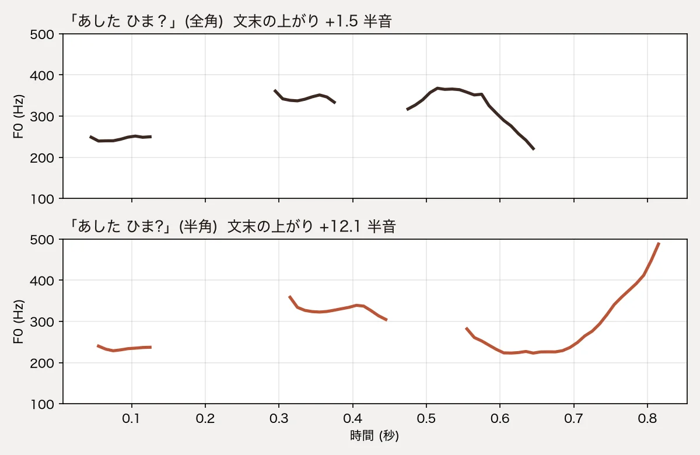

チャットの返事を ElevenLabs の TTS で読み上げています。声は日本語の音声から作ったクローン (Instant Voice Clone)、モデルは `eleven_v4_turbo` です。あるとき、返事の最後が「〜ちかい？」という問いなのに、音声では文末が下がって言い切りに聞こえました。

原因を探して設定やモデルを変えて測ったところ、効いたのは全角の「？」を半角の「?」に変えることでした。

## 結論

- 全角の「？」で文末が上がらないのは、「あした ひま？」のような言い切りの形の問いです。「どこに 行った？」のように疑問詞がある文や、「〜の？」「〜かな？」で終わる文は、全角でも上がりました
- 半角の「?」に変えると、試した 6 文はどれも上がりました
- stability を 0 にする、`[curious]` タグを付ける、「？？」「…？」にする、モデルを変える、では安定して上がりませんでした
- 公式のドキュメントに、全角と半角の違いや、疑問文の上がりについての記述は見つかりませんでした

日本語の返事を ElevenLabs で読ませているなら、送る直前に全角の「？」を半角にすれば済みます。画面に出す文は全角のままで構いません。

## 聞き比べ

同じ声・同じ設定で「あした ひま」の後ろの記号だけを変えたものです。

全角「？」:

[再生する (別のタブで開きます)](https://cdn.jsdelivr.net/gh/mohhh-ok/blog-examples@main/2026/11-05-elevenlabs-question-mark/output/ashita-hima-fullwidth.wav)

半角「?」:

[再生する (別のタブで開きます)](https://cdn.jsdelivr.net/gh/mohhh-ok/blog-examples@main/2026/11-05-elevenlabs-question-mark/output/ashita-hima-halfwidth.wav)

声の高さ (F0) を見ると、全角は「ま」で下がって終わり、半角は「ま」の後半で大きく上がっています。

## 測り方

上がったかどうかは耳だけで決めず、数字にしました。最後の有声区間 (声帯が震えている区間) の中で、いちばん低い所から終わりまでに F0 が何半音上がったかを測ります。ピッチの推定は Praat (parselmouth) です。

測った値は 1 本 (+6.5) を除いて、+3 半音以下か +7.5 半音以上のどちらかに分かれました。この記事では +6 半音以上を「上がった」としています。

各条件 2 本ずつ作りました。設定を書いていないものは `eleven_v4_turbo`・`language_code: ja`・voice_settings は既定です。

## 試したこと

文は「まさは 京都の おてらに ちかい？」で、最後の記号や設定だけを変えました。

| 変えたこと | 1 本目 | 2 本目 | 上がったか |
| --- | --- | --- | --- |
| そのまま (全角「？」) | +0.9 | +0.2 | × |
| 頭に `[curious]` | +0.1 | +0.4 | × |
| stability 0 (既定 0.5) | +0.1 | +0.1 | × |
| 「？？」 | +0.1 | +0.1 | × |
| 「…？」 | +0.3 | +0.0 | × |
| 頭に `[questioning]` (全角「？」のまま) | +9.2 | +7.5 | ○ |
| 半角「?」 | +8.7 | +8.3 | ○ |
| 「ちかいの？」に書き換え | +8.9 | +9.1 | ○ |
| モデル `eleven_v4` | +1.4 | +1.7 | × |
| モデル `eleven_v3` | +0.4 | +2.3 | × |
| モデル `eleven_multilingual_v2` | +2.6 | +3.0 | × |
| モデル `eleven_flash_v2_5` | +6.5 | +2.7 | 1 本だけ |

(単位は半音)

上がったのは、`[questioning]` タグ、半角「?」、文の終わりを「の？」に変える、の 3 つでした。

`[questioning]` は効きますが、文の頭にタグを足す必要があります。文の終わりを変える方法は、読み上げる文そのものを書き換えることになります。記号を 1 つ変えるだけの半角が、いちばん手軽です。

モデルを変えても安定しませんでした。`eleven_multilingual_v2` と `eleven_flash_v2_5` は声の高さの底が約 330Hz で、v4 系 (約 190Hz) と声の聞こえ方も変わります。

## 5 文での確かめ

1 文だけでは偶然かもしれないので、形の違う 5 文を全角と半角で 2 本ずつ作りました。

| 文 | 全角「？」 | 半角「?」 |
| --- | --- | --- |
| マサは 京都に すんでる | +1.2 / +1.4 | +14.1 / +14.0 |
| あした ひま | +1.5 / +0.5 | +12.1 / +9.7 |
| きのう どこに 行った | +8.2 / +10.4 | +9.4 / +9.1 |
| けさ なにを 食べた | +12.9 / +8.4 | +13.3 / +12.6 |
| すし、好き | +9.4 / +9.9 | +10.6 / +9.7 |

(単位は半音)

半角は 10 本とも上がりました。全角で上がらなかったのは「すんでる」「ひま」の 2 文で、どちらも記号を外すと平叙文と同じ形になる文です。疑問詞 (どこ・なに) のある文は全角でも上がりました。

「すし、好き」は言い切りの形ですが、全角でも上がっています。なぜこの文だけ上がるのかは分かっていません。

別のクローン声でも、半角で 2 文 (「すし、好き?」「きのう どこに 行った?」) を作り、+7.9 と +10.3 で上がりました。

全角で上がる文もあるので、「全角だと問いと分からない」わけではなさそうです。私の推測ですが、言い切りの形の文では、全角の「？」が問いの手がかりとして弱く扱われているのかもしれません。

## 公式に書かれていること

同じ症状の報告は、公式のドキュメントと changelog、GitHub の SDK の issue (elevenlabs-python・elevenlabs-js)、日本語と英語のブログでは見つかりませんでした。Reddit と help.elevenlabs.io は開けなかったので確かめていません。

公式に「？で文末が上がる」と書いた所もありません。[Best practices](https://elevenlabs.io/docs/overview/capabilities/text-to-speech/best-practices) の v4 の句読点の説明は、三点リーダ・大文字・標準の句読点を挙げているだけで、疑問符には触れていません。

> Punctuation significantly affects delivery in v4

クローン声については、学習音声に無い言い方は出にくい、と同じページに書かれています。

> A voice that has never whispered should still be able to follow [whispering] … However, it might be less reliable

[Voice cloning](https://elevenlabs.io/docs/eleven-api/concepts/voice-cloning) には、Instant Voice Clone は Professional Voice Clone より話し方の幅を再現しにくいとあります。

> Fine-tuning allows the model to capture voice characteristics more deeply, including stylistic tendencies that IVC cannot reliably reproduce.

問いの言い方を含む音声で声を作り直せば全角でも上がるのかは、ここからは分かりません。[Eleven v4](https://elevenlabs.io/docs/overview/capabilities/text-to-speech/eleven-v4) の説明は学習音声の話し方を 1 つにそろえるよう勧めていて、多様な感情を入れるよう勧める [ブログ](https://elevenlabs.io/blog/voice-cloning-deep-dive) とは向きが違います。

v4 では Style と Speed の設定が無く、SSML も使えません ([Eleven v4](https://elevenlabs.io/docs/overview/capabilities/text-to-speech/eleven-v4))。触れるのは Stability と Similarity で、stability を 0 にしても上がらなかった結果とも合います。

モデルごとの疑問文の違い、全角と半角の扱いの違い、`previous_text` などの前後の文が上がりに効くかについては、記述が見つかりませんでした。

## 対処

ElevenLabs に送る直前に、次の置き換えをしています。

1. 続く「？？」を 1 つの「？」にまとめる (「？？」でも上がらなかったため)
2. 「？」の後ろに文が続くときは、空白を 1 つ挟む (記号と次の語がつながって読まれないように)。後ろが閉じ括弧や「！」のときは挟まない
3. 全角の「？」を半角の「?」にする

画面に出す文は全角のまま変えません。TTS の結果をキャッシュしているなら、キャッシュの鍵が置き換え前の文で作られていないかを確かめてください。置き換え前の文が鍵なら、置き換えを入れても古い音声が返り続けるので、鍵の版を上げて作り直します。

置き換えの関数とテスト、F0 の測り方は [blog-examples](https://github.com/mohhh-ok/blog-examples/tree/main/2026/11-05-elevenlabs-question-mark) に置きました。

## 確かさの限界

- 各条件 2 本ずつで、本数は少ないです
- 主に 1 つのクローン声で測りました。もう 1 つの声は半角の 2 本だけです
- 5 文での確かめは `eleven_v4_turbo` だけです。他のモデルで全角と半角を比べてはいません
- ElevenLabs のモデルは更新されるので、2026-11-05 時点の結果です
