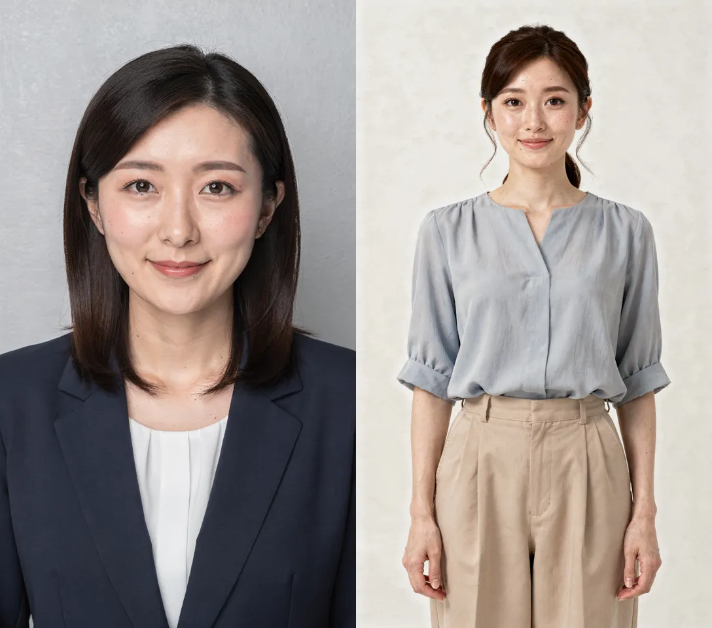
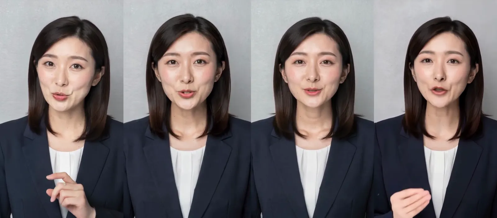
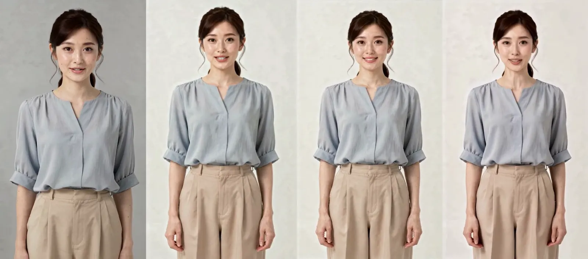
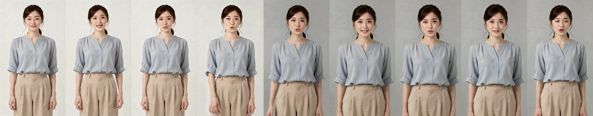
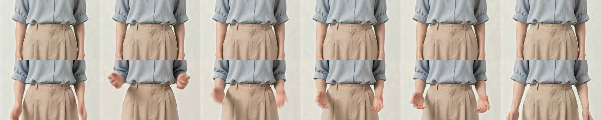
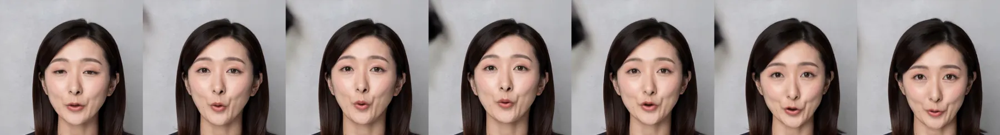

こんにちは、フリーランスエンジニアのmohです。この記事はほとんどAIが書いたものを、私が加筆修正しています。検証不十分な部分もあるかと思いますが、ご容赦ください。ご指摘等ございましたら、Github issueか、Xでお願いいたします。

人物の写真 1 枚と音声を渡すと、その人が喋る動画を返すモデルが fal.ai にいくつかあります。そのうち 4 つに同じ写真と同じ音声を渡して、価格・待ち時間・画質・破綻を比べました。単価とスキーマは 2026-10-11 に確認したものです。

- OmniHuman v1.5 (`fal-ai/bytedance/omnihuman/v1.5`)
- FlashTalk (`fal-ai/flashtalk`、SoulX-FlashTalk 14B)
- HeyGen Avatar IV (`fal-ai/heygen/avatar4/image-to-video`)
- Kling AI Avatar v2 Pro (`fal-ai/kling-video/ai-avatar/v2/pro`)

## 結論

価格で選ぶなら FlashTalk、動きの安定で選ぶなら HeyGen、動きの大きさなら OmniHuman、解像度なら Kling です。どれも口は音声に合わせて動きました。

- FlashTalk は 1 分 $1.20 で、ほかの 3 つ ($6.00〜9.60) の 1/5 以下です。代わりに出力が 448x768 と小さく、歯の色や手の動きに崩れが出ました
- HeyGen は背景と体の位置がほぼ動かず、元の写真の背景がそのまま残りました。待ち時間も 4 つで最短です。動くのは頭と表情だけで、手は動きません
- OmniHuman は頭・手・表情が最もよく動きます。最も高く (1 分 $9.60)、太もも上の写真では途中でカメラが寄り、背景の色も変わりました
- Kling は 1072x1904・30fps と最も高解像度です。肌がなめらかになってそばかすやほくろが薄くなり、上半身の版では背景に約 0.5 秒、黒い塊が出ました

## 比べた条件

### 入力の写真

実在の人物は使わず、`fal-ai/flux-2-pro` で 2 枚生成しました。どちらも 1088x1920 (9:16)、PNG です。

- 上半身 (seed 1011): "Photorealistic smartphone-style portrait photo of a Japanese woman in her late 20s, framed from the chest up, facing the camera directly, calm friendly expression with lips gently closed, shoulder-length dark hair, wearing a navy blazer over a white blouse, plain light gray studio wall background, soft even front lighting, sharp focus, natural skin texture, hands out of frame"
- 太もも上 (seed 1012): "Photorealistic photo of a Japanese woman in her 30s standing upright, framed from the knees up, facing the camera directly, relaxed posture with both arms hanging naturally at her sides, calm friendly expression with lips gently closed, hair tied back, wearing a light blue blouse and beige wide trousers, plain off-white studio background, soft even lighting, sharp focus, natural skin texture"。膝上を指定しましたが、出力は太もも上までになりました。手は写っています

### 入力の音声

`fal-ai/minimax/speech-02-hd` で作りました。voice_id は `Calm_Woman`、speed 1、mp3 です。写真が 2 枚とも女性なので、両方に同じ声を使いました。

- 日本語 (17.2 秒、language_boost Japanese): 「こんにちは。今日は、写真一枚から話す動画を作れる、新しい機能をご紹介します。撮影スタジオに行かなくても、お手持ちの写真と原稿だけで、ナレーション付きの動画がすぐに完成します。ぜひ一度、お試しください。」
- 英語 (13.4 秒、language_boost English): "Hi there. Today I'd like to show you a new feature that turns a single photo into a talking video. No studio and no camera crew. Just upload your picture, add a script, and your narrated video is ready in minutes. Give it a try."

### 組み合わせと設定

日本語は写真 2 枚 × 4 モデルの 8 本、英語は上半身 × 3 モデル (Kling を除く) の 3 本、計 11 本です。英語から Kling を外したのは、予算 $20 に収めるためです。

- OmniHuman v1.5: resolution 720p (スキーマの説明に「720p のほうが速く品質も高い」とあるため)。turbo_mode と prompt は指定なし
- FlashTalk: seed 42。入力は写真・音声・seed だけです
- HeyGen: aspect_ratio 9:16、resolution 720p、talking_style は既定の stable。background は指定なし
- Kling: prompt は既定の "."

11 本を同時に fal の queue に入れ、投入から結果の取得までの時間を測りました。

## 価格・時間・解像度

| モデル | 単価 | 1 分あたり | 出力 | 生成時間 (日本語 17.2 秒) |
| --- | --- | --- | --- | --- |
| OmniHuman v1.5 | $0.16/秒 | $9.60 | 704x1248・25fps | 411〜418 秒 |
| FlashTalk | $0.02/秒 | $1.20 | 448x768・25fps | 301〜342 秒 |
| HeyGen Avatar IV | $0.10/秒 | $6.00 | 720x1280・25fps | 178〜207 秒 |
| Kling AI Avatar v2 Pro | $0.115/秒 | $6.90 | 1072x1904・30fps | 447〜473 秒 |

- 単価は fal の公開価格です。費用は「単価 × 応答に入っている課金秒数」で計算しました。fal の請求額そのものは確かめていません。入力の生成を含めた 11 本の合計は約 $17.6 でした
- 生成時間は fal の待ち行列を含む実測で、時間帯で変わります。FlashTalk は推論そのものは 29〜38 秒で、残りは待ち行列でした。OmniHuman の英語版 (13.4 秒) は 509 秒かかりました
- 1 分の動画を作ったときの時間は測っていません
- 音声の長さの上限は、OmniHuman だけスキーマに書かれています (1080p で 30 秒、720p で 60 秒)。ほかの 3 つは書かれておらず、確かめていません。1 分を超える動画を OmniHuman で作るなら、音声を分けて生成することになります
- FlashTalk のスキーマには「768x448」とありますが、縦の写真を渡すと 448x768 の縦で返りました
- Kling の出力は 17.333 秒で、音声 (17.17 秒) より 0.16 秒長くなりました

## 見た目の違い

同じ時刻のフレームを、左から OmniHuman・FlashTalk・HeyGen・Kling の順に並べます。

### OmniHuman v1.5

- 頭の動き・まばたき・表情が 4 つで最も大きいです。上半身の写真では、写っていない手を画面の外から出して、指を立てたり胸の前で手を組んだりしました。指の数や形の崩れは見当たりませんでした
- 顔は元の人物と分かりますが、フレームによって輪郭や目元の印象が少し変わります
- 太もも上の写真では、6〜8 秒のあいだに背景が白っぽい色からグレーに変わり (左上の明るさが 229 から 175 へ)、同時にカメラがゆっくり寄って人物が大きくなりました。そのあとは最後まで寄った構図のままです

### FlashTalk

- 顔は元の人物のままで、口は笑顔寄りの形が多めです
- 解像度が低いぶん、顔の細部はやわらかく見えます
- 英語版の 6.8〜7.2 秒、口が半分開いた場面で、歯が灰緑色に濁るフレームがありました
- 太もも上の写真では手を前に出す身ぶりをしますが、手を出し入れする数フレームで手がぶれて半透明になりました (日本語版 8〜10 秒付近)
- 背景の明るさは変わりません。ただ、背景の細かな揺れは HeyGen や Kling より大きめでした (後述の数値)

### HeyGen Avatar IV

- talking_style が stable のとき、体と手はほぼ動かず、頭のわずかな動きと表情・まばたきだけが動きます
- 顔は元の人物のままで、歯もきれいでした。崩れは見当たりませんでした
- background を指定しないと、元の写真の背景がそのまま残りました。スキーマ上の既定値は白の単色ですが、白には置き換わりませんでした
- 背景と体の位置が最も安定していました。動画の上に別の映像を重ねる・人物を切り抜くといった後処理をするなら、位置が動かないぶん扱いやすいと思います (推測で、切り抜きは試していません)

### Kling AI Avatar v2 Pro

- 解像度は 4 つで最も高い 1072x1904・30fps です
- 上半身の写真では、手を作り出して胸の前で身ぶりをしました。手の形は自然で、速く動く場面で少しぶれる程度です
- 肌がなめらかになり、元の写真のそばかすやほくろが薄くなります。人物は元の写真と分かります
- 上半身の版の 5.6〜6.1 秒、背景の左上に黒い塊が出て消えました
- 太もも上の写真では、体の位置も背景も安定していました

## 背景の揺れの数値

背景がどれだけ動くかを数字でも見ました。左上の背景 (幅 15%・高さ 12%) を切り抜き、隣り合うフレームの差の平均と、最初のフレームからの差の最大を出しています。値は 0〜255 の明るさの差です。

| モデル | 写真 | 隣のフレームとの差 (平均) | 最初のフレームとの差 (最大) |
| --- | --- | --- | --- |
| OmniHuman v1.5 | 上半身 | 0.26 | 12.3 |
| OmniHuman v1.5 | 太もも上 | 0.34 | 58.2 |
| FlashTalk | 上半身 | 0.31 | 2.6 |
| FlashTalk | 太もも上 | 0.38 | 2.2 |
| HeyGen Avatar IV | 上半身 | 0.11 | 3.9 |
| HeyGen Avatar IV | 太もも上 | 0.12 | 2.6 |
| Kling AI Avatar v2 Pro | 上半身 | 0.48 | 89.8 |
| Kling AI Avatar v2 Pro | 太もも上 | 0.10 | 3.9 |

OmniHuman の太もも上 (58.2) は背景の色が変わったこと、Kling の上半身 (89.8) は黒い塊が出たことによる値です。HeyGen は 2 枚とも小さく、FlashTalk は色は変わらないものの細かく揺れています。

## 口の動きと音声

4 つとも、口は入力の音声に合わせて動いていました。

1. 口元を固定位置で切り抜き、隣り合うフレームの差を口の動きの量とする
2. 音声の音量の変化を 25fps で並べ、口の動きの量との相関を出す
3. 対照として、同じ動画に別の音声を組み合わせた相関も出す

| モデル | 上半身 | 太もも上 |
| --- | --- | --- |
| OmniHuman v1.5 | 0.26 | (使えない) |
| FlashTalk | 0.28 | 0.29 |
| HeyGen Avatar IV | 0.16 | 0.11 |
| Kling AI Avatar v2 Pro | 0.18 | 0.22 |

別の音声と組み合わせた対照は -0.07〜0.01 で、4 つともそれより高く出ています。値の差は、口の開け方の大きさや頭の動きで切り抜きがずれる影響が大きいと見ていて (推測)、この値でモデルの順位は付けていません。OmniHuman の太もも上の版は、カメラが寄って 6 秒以降に切り抜きが口から外れたため使えませんでした。

話し始め (無音から「こんにちは」に入るところ) で、口が動き出すタイミングと音声が鳴り出すタイミングの差も見ました。1 フレームは 40ms で、正の値は映像が遅れていることを表します。

| モデル | 上半身 | 太もも上 |
| --- | --- | --- |
| OmniHuman v1.5 | +5 | +1 |
| FlashTalk | 0 | 0 |
| HeyGen Avatar IV | +2 | 0 |
| Kling AI Avatar v2 Pro | -1 | -1 |

OmniHuman の上半身の版だけ、口が 200ms 遅れて動き出しました。ほかは ±2 フレーム以内です。

日本語の口の形 (「こんにちは」の「お」など) は、4 つとも静止フレームで音に合う形が見られました。自然さの差は静止フレームでは判断できず、動画を見比べる必要があります。

## 選び方

- 価格を抑えたい、小さな画面で見せる: FlashTalk。解像度と手の崩れは許容できるかを先に確かめてください
- 背景や人物の位置を動かしたくない、待ち時間を短くしたい: HeyGen。手振りは出ません
- 身ぶりや表情を大きくしたい: OmniHuman。広めの構図の写真ではカメラが寄ることがあり、出力の構図は入力どおりにならない場合があります
- 高解像度で出したい: Kling。肌の質感が変わる点と、まれに背景が崩れる点を確認してください

## 指標の限界

- 写真 2 枚・音声 2 本・各組み合わせ 1 回の生成です。seed や生成のたびに結果が変わる範囲は測っていません
- 見た目の所見は、各動画から等間隔に切り出した 6 枚のフレームと顔の拡大を目で見たものです。崩れが疑わしい場面は前後を 0.1〜0.4 秒間隔で切り出して確かめました
- 口と音声の相関は、顔を検出せず固定位置で切り抜いた値なので、頭が大きく動く出力では下がります。目視の補助として扱ってください
- 費用は単価と応答の秒数からの計算で、実際の請求額は確かめていません
- OmniHuman v1 (v1.5 の旧版)、Mirage Avatar X、InfiniTalk、VEED Fabric 1.0、LongCat Single Avatar、Creatify Aurora も fal にありますが、試していません

## 参考

- [OmniHuman v1.5 (fal.ai)](https://fal.ai/models/fal-ai/bytedance/omnihuman/v1.5)
- [FlashTalk (fal.ai)](https://fal.ai/models/fal-ai/flashtalk)
- [HeyGen Avatar IV image-to-video (fal.ai)](https://fal.ai/models/fal-ai/heygen/avatar4/image-to-video)
- [Kling AI Avatar v2 Pro (fal.ai)](https://fal.ai/models/fal-ai/kling-video/ai-avatar/v2/pro)
