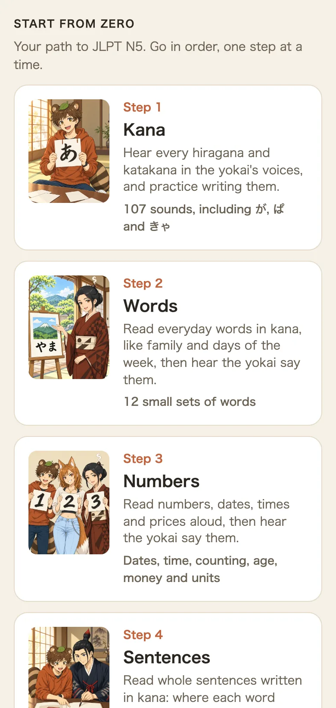
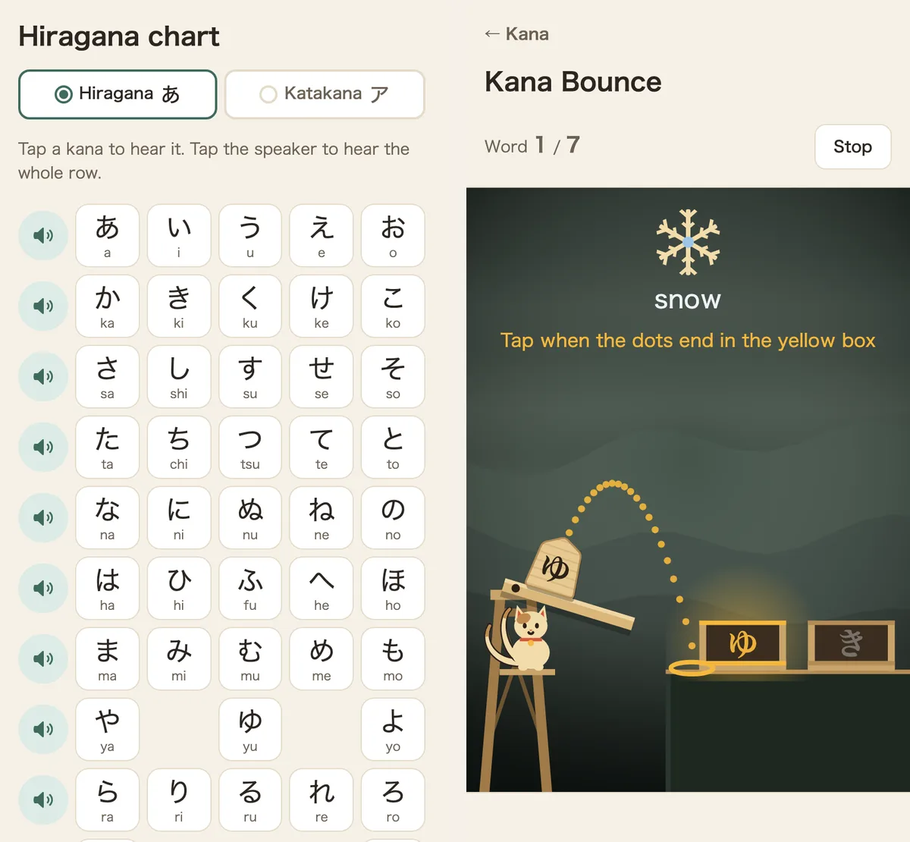
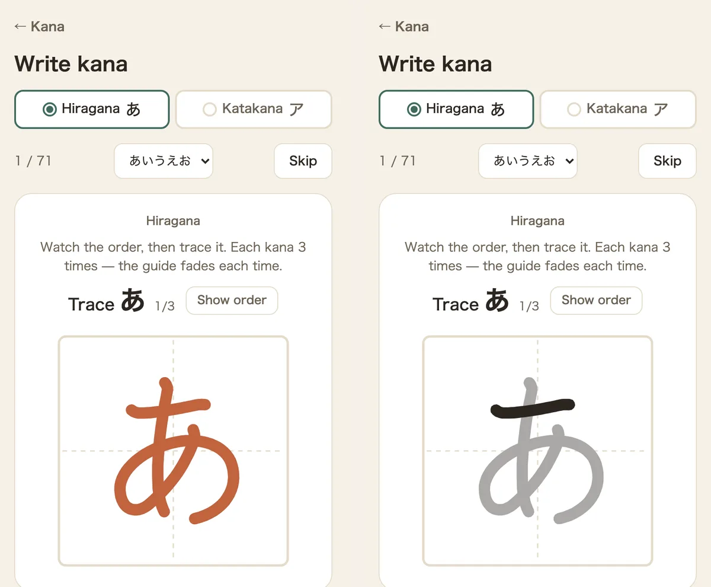
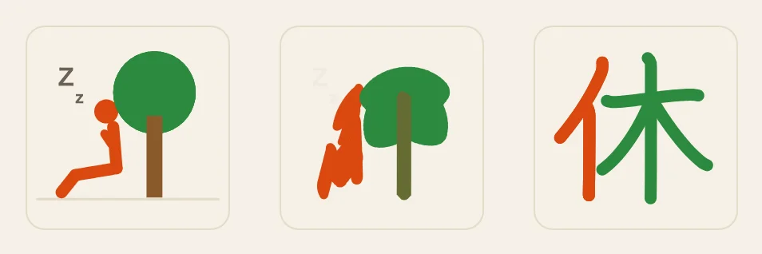
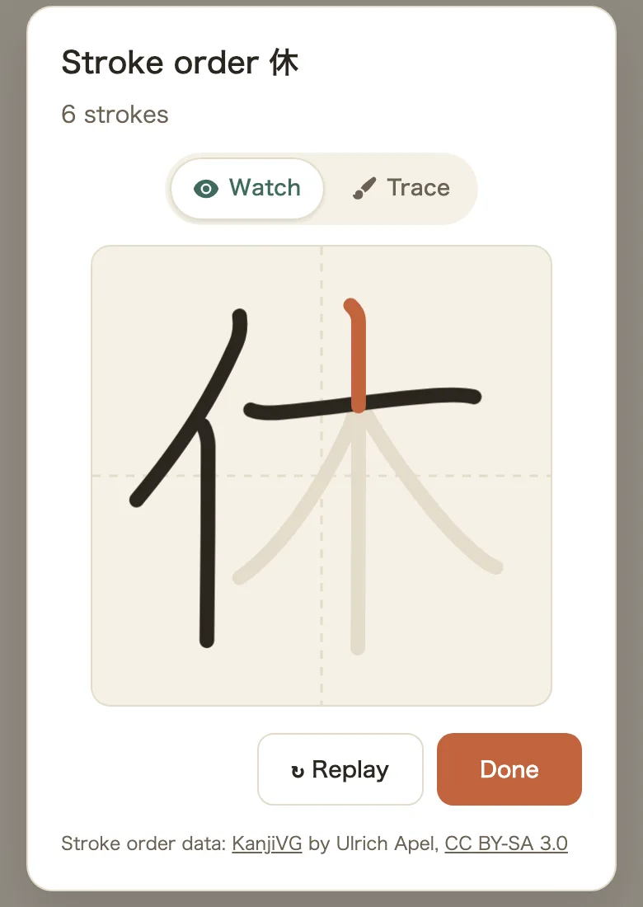
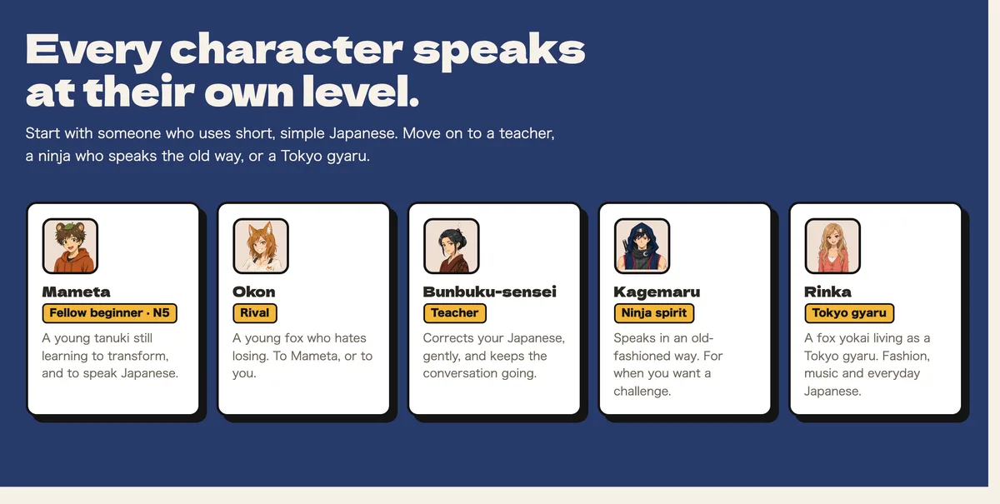
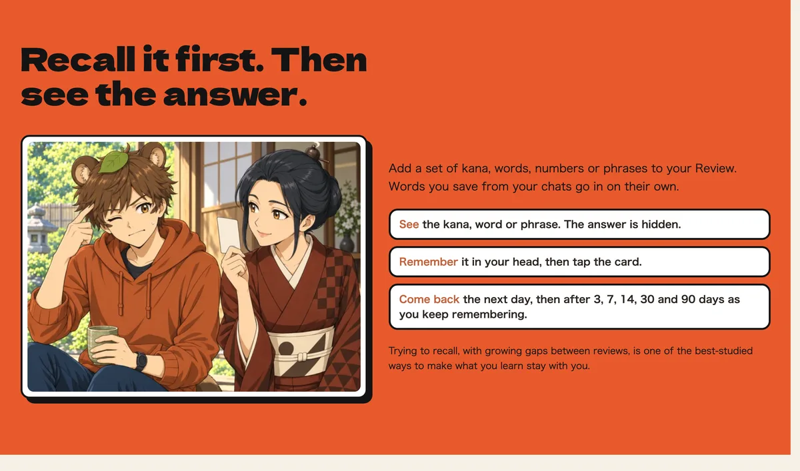

Hi, I'm moh, a freelance software engineer in Japan. If you spot anything wrong, let me know through a GitHub issue or on X.

I built Kotoyokai for English speakers who want to learn Japanese and are starting from nothing. You begin by listening to hiragana and tracing it with your finger, and you keep going until you're chatting in Japanese with a tanuki, a fox, a ninja spirit and a Tokyo gyaru. Kana, kanji and travel phrases are free, and every lesson audio clip has been checked by me, a native Japanese speaker, before it goes live.

https://kotoyokai.com/mohblog

## Who it's for

Kotoyokai is for you if you can't read hiragana yet. Maybe anime or a planned trip got you curious, but a textbook feels like too much.

The whole app is in English, and it decides the order for you. The home screen lays out a path to JLPT N5 in five steps: Kana, Words, Numbers, Sentences, then Kanji. Start at Step 1 and keep going down. You never have to work out what to study next.

## Start with kana

Kana come first. Tap any character on the chart and you hear it in a character's voice. All 107 sounds of hiragana and katakana are there, including voiced sounds like が (ga) and combined sounds like きゃ (kya), read by Mameta the tanuki and Okon the fox.

Then you make them stick with games. In Kana Bounce, kana fall from the top and you bounce them into boxes to spell a word. In the screenshot on the right, the clue is "snow": you bounce ゆ (yu) into the first box, then き (ki), and you get ゆき (yuki), "snow". One round is 7 words and takes about a minute. Kana Flick gets you used to the flick keyboard Japanese people use on their phones.

Listening alone won't teach you to write, so there's a writing drill too. You trace a model character three times, and the model fades a little each round until you're writing on your own. All 71 basic kana are covered.

## Audio you can trust

Every audio clip in Kana, Words, Numbers, Phrases and the yen game is generated, then listened to by me. I only keep the ones with the right reading and the right pitch accent.

This matters because a beginner can't hear a mistake in the model. An advanced learner notices when the accent is off. Someone who just learned hiragana copies it as is. Text-to-speech makes mistakes: it sometimes turns へ (he) into a different sound, or puts the accent on the wrong part of a word. I run an automatic reading check first, and then a human ear makes the final call.

For you, this means you can copy what you hear without second-guessing it. The exceptions are chat replies and lesson hints. Those are generated live, so nobody can check them in advance, and the site says so.

## Kanji with pictures and stroke order

There are 2,211 kanji from N5 to N1, and every one has its stroke order.

Some kanji have a "Picture it" section that breaks the character into parts and draws them. For 休, a person leaning against a tree to rest slowly turns into the shape of 休 itself. While the page is open, it keeps moving back and forth between the picture and the character.

"Watch" plays the strokes one at a time, and "Trace" lets you write them yourself. When you know a kanji, tap "I know this kanji" to add it to your collection, and you'll see how many more words you can now read.

## Phrases and yen for your trip

If you're planning a trip to Japan, there are phrase sets grouped by place: any shop, café, restaurant, convenience store, train, airport, phone, Wi-Fi and SIM, taxi, hotel and slang. Every phrase has audio.

In the yen game, a character says a price in Japanese and you pay with bills and coins. Hearing よんひゃくきゅうじゅうはちえん (yonhyaku kyūjū hachi en) and handing over ¥498 right away is harder than it sounds. Once that's easy, try a trick people in Japan use all the time: for a ¥3,828 bill, hand over ¥4,028 and get a clean ¥200 back.

## Chat with the characters

Once you know your kana, you can chat with the characters in Japanese. Their replies are read aloud, and you can open an English translation. Tap any word in a reply to see what it means, and save it to your vocabulary book.

Each character speaks Japanese at their own level. Mameta is a beginner like you and only uses short, simple sentences. Okon is his rival, a young fox who hates losing. When you're ready for more, move on to Bunbuku-sensei, a teacher who gently corrects your mistakes, Kagemaru, a ninja spirit who still talks the old way, and Rinka, a fox yokai living as a Tokyo gyaru. The home screen lines up eight characters from beginner to advanced.

If you don't know what to say, try Lessons. They are short role-plays, like meeting Mameta for the first time or talking with Okon about what you like. You get a role and a mission up front, and the lesson ends when you complete the mission in Japanese.

## Review keeps it in your head

You can add any set of kana, words or phrases to your Review. Each card hides the answer, so you recall it first and then tap to check. Cards you remember come back the next day, then after 3, 7, 14, 30 and 90 days. Words you save from chats go in on their own.

Trying to recall, with growing gaps between reviews, is one of the best-studied ways to make what you learn last. Kotoyokai keeps track of the schedule, so you don't have to decide what to review or when.

## What's free

Most of it. Kana, words, numbers, all kanji from N5 to N1, travel phrases and the yen game have no limit. Chat is free for 10 messages a day without signing up, and signing up adds 42 more messages, once.

You only pay if you want more than 3 sets in Review, or want to chat a lot. Review Unlimited is $19.99 once, with no monthly fee. For heavy chatting there's a 30-day Premium Pass at $9.99 that doesn't renew on its own, and point packs.

## Try it

On the web you can start right away without an account. The iPhone app is on the App Store.

- Web: https://kotoyokai.com/mohblog
- iOS: https://apps.apple.com/us/app/kotoyokai-learn-japanese-kana/id6813738172

If something is confusing or you have feedback, I'd love to hear it on X.
