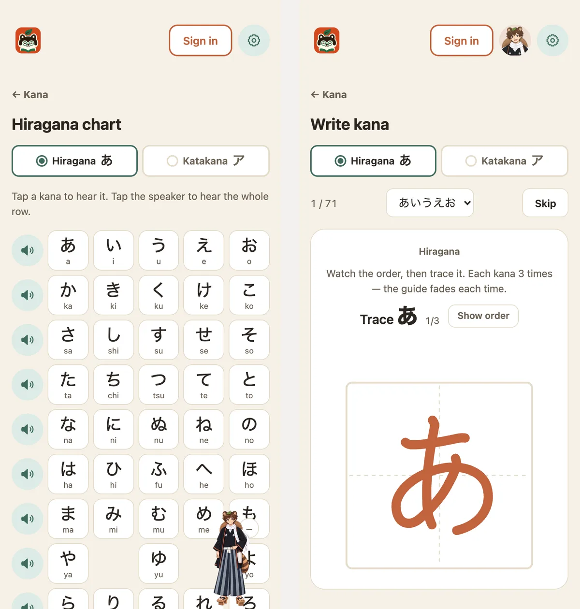
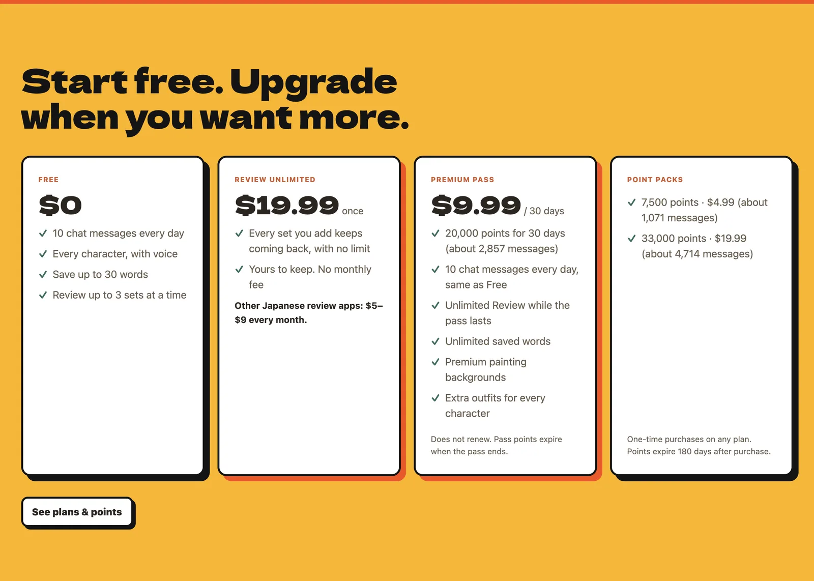

Hi, I'm moh, a freelance software engineer in Japan. If you spot anything wrong, let me know through a GitHub issue or on X.

I built Kotoyokai for English speakers who want to learn Japanese and are starting from nothing. It's a course that begins with your first hiragana and moves one short lesson at a time, with a yokai buddy in the corner of every page you can ask when you're stuck. The course, kana, kanji, travel phrases and games are free, and every lesson audio clip has been checked by me, a native Japanese speaker, before it goes live.

https://kotoyokai.com/mohblog

## Who it's for

Kotoyokai is for you if you can't read hiragana yet. Maybe anime or a planned trip got you curious, but a textbook feels like too much.

The whole app is in English, and it decides the order for you. You don't have to work out what to study next: open the course, tap Continue, and do the next lesson.

## The course

The course is 152 short lessons in 10 areas: Hiragana, Basics, Katakana, People, Food and drink, Home and clothes, Animals and nature, Around town and travel, Kanji N5 and Kanji N4. Short sentences come in along the way, and kanji come last.

Each lesson shows you something new, like a letter, a word or a short sentence, and reads it aloud. Then you answer a few quick questions: pick the right reading, match pairs, or put a sentence in order. If you already read kana, you can open any lesson and skip ahead.

## Your buddy

You pick one buddy: Mameta, a young tanuki still learning to transform, or Okon, a young fox who hates losing. Your buddy stands in the corner of every page.

In a lesson, tap your buddy and ask about the question you're on. You can ask in English. The reply comes in easy Japanese with an English line under it, and it's read aloud. Outside lessons, you can just chat with your buddy in Japanese, using the words you learned that day.

## Kana, kanji and phrases on their own

Besides the course, each topic has its own page, and all of them are free.

- Kana: a chart with all 107 sounds of hiragana and katakana, including が, ぱ and きゃ. Tap a kana to hear it. In Write, you trace each of the 71 basic kana three times, and the guide fades each time.
- Words: 454 everyday words in 47 small sets, like greetings, days of the week and family.
- Numbers and Sentences: dates, times, prices, and how は, を and へ are read in a sentence.
- Kanji: all 2,211 kanji from N5 to N1, each with stroke order you can watch or trace. With a free account, mark the ones you know, and you'll see how many words you can now read.
- Phrases: sets grouped by place, like any shop, café, restaurant, convenience store, train, airport and hotel, plus slang. Every phrase has audio.

There are short games too: Kana Bounce, where you bounce falling kana into boxes to spell a word, Kana Flick for the phone keyboard people in Japan use, and Paying. In Paying, a yokai says a price in Japanese and you pay it with yen bills and coins. Once that's easy, try paying like a local: for a ¥3,828 bill, hand over ¥4,028 and get a clean ¥200 back.

## Audio you can trust

Every audio clip in the course, Kana, Words, Numbers, Sentences, Phrases and Paying is generated, then listened to by me. I only keep the ones with the right reading and the right pitch accent.

This matters because a beginner can't hear a mistake in the model. An advanced learner notices when the accent is off. Someone who just learned hiragana copies it as is. Text-to-speech makes mistakes: it sometimes turns へ (he) into a different sound, or puts the accent on the wrong part of a word. I run an automatic reading check first, and then a human ear makes the final call.

For you, this means you can copy what you hear without second-guessing it. The exceptions are your buddy's replies and lesson hints. Those are generated live, so nobody can check them in advance, and the site says so.

## Review keeps it in your head

You can add any set of kana, words, numbers or phrases to your Review. Each card hides the answer, so you recall it first and then tap to check. Cards you remember come back the next day, then after 3, 7, 14, 30 and 90 days. Words you save from chats go in on their own.

Kotoyokai keeps track of the schedule, so you don't have to decide what to review or when.

## What's free

Most of it. The course, kana, words, numbers, all kanji from N5 to N1, travel phrases and all the games have no limit, and you can start without signing up. Chatting with your buddy is free for 10 messages a day, and making a free account adds 42 more messages, once.

You only pay if you want more than 3 sets in Review, or want to chat a lot. Review Unlimited is $19.99 once, with no monthly fee. For heavy chatting there's a 30-day Premium Pass at $9.99 that doesn't renew on its own, and point packs.

## Try it

On the web you can start lesson 1 right away without an account. The iPhone app is on the App Store.

- Web: https://kotoyokai.com/mohblog
- iOS: https://apps.apple.com/us/app/kotoyokai/id6813738172

If something is confusing or you have feedback, I'd love to hear it on X.
