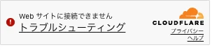
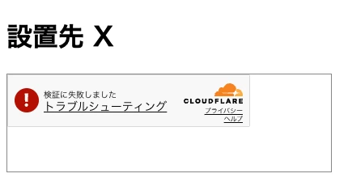

こんにちは、フリーランスエンジニアのmohです。この記事はほとんどAIが書いたものを、私が加筆修正しています。検証不十分な部分もあるかと思いますが、ご容赦ください。ご指摘等ございましたら、Github issueか、Xでお願いいたします。

他社のサイトに script タグ 1 行で設置するウィジェットを作るとき、訪問者が bot でないかを Cloudflare Turnstile で確かめたくなります。ところが Turnstile は、widget を出すページのホスト名を事前に登録する必要があります。設置先が増えるたびに登録するのは現実的ではありません。

そこで、設置先のページには自前ドメインの iframe だけを置き、Turnstile はその iframe の中で出す形を試しました。

## 結論

- 設置先のページに置いた自前ドメインの iframe の中で、Chrome 156 と Safari 27 のどちらでも token が取れ、Siteverify は `success: true` でした
- Siteverify が返す `hostname` は iframe 側の自前ドメインでした。設置先のホスト名は登録しなくて済みます
- その代わり、`hostname` からはどのサイトに設置されたかが分かりません。設置先の判定は別に作る必要があります
- 設置先のページに同じ sitekey で直接出すと、エラー 110200 (Domain not authorized) になりました
- Playwright で動かしたブラウザでは、headless・headed・本体の Chrome のどれでも 600010 になり、token は取れませんでした。この計測は人が普段のブラウザで押して行っています
- 設置先ごとの key と `Origin` を確かめるだけの口は、curl で `Origin` を付けて送ると 200 で通りました。Turnstile の token も確かめる口は、偽装だけでは 403 でした
- iframe のページに `frame-ancestors` (key に登録したドメインだけ) と `Sec-Fetch-Dest: iframe` の確認を入れると、Chromium と WebKit のどちらでも、登録外のサイトに置いたときと直接開いたときは描画されませんでした
- Turnstile の解決サービスと、ブラウザ以外からヘッダーを偽装して iframe のページを取る経路は残ります

## ホスト名の登録の上限

Turnstile の widget には、動かすホスト名を登録します。[公式のホスト名の管理のページ](https://developers.cloudflare.com/turnstile/additional-configuration/hostname-management/) によると、上限は無料で 1 widget あたり 10 個、Enterprise で 200 個です。ワイルドカードは使えません (登録したホスト名のサブドメインには効きます)。

どのホスト名でも動かせる [Any Hostname](https://developers.cloudflare.com/turnstile/additional-configuration/hostname-management/any-hostname/) は Enterprise だけの機能です。

設置先が数十、数百と増えるウィジェットでは、設置先のページに直接 widget を出す形は無料では成り立ちません。iframe の中で出す形が使えるかは、公式のページには書かれていませんでした。

## 試した構成

- 自前ドメイン Y: Turnstile の widget にホスト名を登録したドメイン。この記事では `widget.example.com` と書きます。手元では `/etc/hosts` で 127.0.0.1 に向け、mkcert の証明書で https にしました
- 設置先 X: `lvh.me`。公開 DNS で 127.0.0.1 を返すドメインで、widget には登録していません。Y とは別のサイト (eTLD+1 が違う) になります
- sitekey は本物を使いました。テスト用の sitekey (`1x000...`) はホスト名を見ないので、この確認には使えません

ページは 3 つです。

1. Y に直接 widget を出すページ。Y が登録済みで token が取れることの確認
2. X のページに Y の iframe を置き、iframe の中で widget を出すページ。これが本題です
3. X のページに直接 widget を出すページ。対照です

widget の結果 (token かエラー) は Y のサーバーに送り、サーバーが token ごとに Siteverify を呼んで、応答をそのまま記録しました。計測は 2026-10-24 です。

## 結果

普段使いの Chrome と Safari で、人がページを開いて押した結果です。

| ブラウザ | ページ | token | Siteverify の success | hostname |
|---|---|---|---|---|
| Chrome 156 | 1. Y に直接 | 取れた | true | Y |
| Chrome 156 | 2. X の中の Y の iframe | 取れた (2 回) | true | Y |
| Chrome 156 | 3. X に直接 | 110200 | - | - |
| Safari 27.0 | 1. Y に直接 | 取れた | true | Y |
| Safari 27.0 | 2. X の中の Y の iframe | 取れた | true | Y |

iframe の中で取れた token の Siteverify の応答は次のとおりです (Safari の回。ホスト名は置き換えてあります)。

```json
{"action":"","cdata":"","challenge_ts":"2026-10-24T12:03:55.000Z","error-codes":[],"hostname":"widget.example.com","metadata":{"interactive":false},"success":true}
```

`metadata.interactive` は、Chrome の iframe の 2 回目だけ `true` でした。チェックボックスを押した回です。他の回は押す前に通っています。

X に直接出したページでは、widget が再試行を続け、約 10 秒ごとに 110200 が届きました (Chrome で 9 回)。[エラーコードの一覧](https://developers.cloudflare.com/turnstile/troubleshooting/client-side-errors/error-codes/) では 110200 は「Domain not authorized」です。



Safari の 3 番 (X に直接) は記録できていません。計測用のサーバーを、Chrome と Safari の両方で 1 番と 2 番が揃ったら止まるようにしていたため、Safari で 3 番を開く前に止まりました。110200 は Chrome と、後で書く Playwright の回で確認しています。

ここから、widget のホスト名の判定は iframe の中のページ (Y) で行われ、親のページ (X) は見ていないと読めます。iframe を cross-site に置いても、Chrome・Safari とも token の取得は妨げられませんでした。

## Playwright では取れない

最初は Playwright で自動化しようとしました。Chromium の headless、本体の Chrome (`channel: "chrome"`) の headed のどちらでも、1 番と 2 番ではチェックボックスが出て、押すと 600010 になりました。600 番台は一覧で「Generic challenge failure」です。



1 番 (Y に直接) でも同じなので、iframe のせいではなく、自動操作のブラウザが bot と判定されていると見ています。3 番は Playwright でも 110200 で、`localhost` に出しても 110200 でした。

Turnstile の挙動を自動テストで確かめたいときは、この点に注意が要ります。ホスト名の判定 (110200 かどうか) までは自動で見られますが、token の取得と Siteverify の中身は人が押して確かめることになります。

## 設置先の見分け方

Siteverify の `hostname` は常に Y になるので、この token がどのサイトから来たかは分かりません。設置先ごとに上限をかけたい場合などは、別の仕組みで見分ける必要があります。

設置のコードには設置先ごとの key (公開してよい値) を入れ、サーバーには key ごとに設置を許したドメインを持たせる形を考えます。ここからは、この形でどこまで守れるかを試した結果です。計測は 2026-10-24、Playwright 1.59.1 の Chromium 147 と WebKit 26.4 (どちらも headless) です。

### key と Origin の確認だけでは、ブラウザ以外を止められない

ブラウザの中の JavaScript は `Origin` ヘッダーを書き換えられません。一方、curl などブラウザ以外のプログラムは `Origin` も `Referer` も好きな値で送れます。key はページのソースに載るので、誰でも読めます。

検証用のサーバーに、key と `Origin` だけを確かめる口 (`/session-origin-only`) と、それに Turnstile の確認を足した口 (`/session`) を作り、curl で送りました。key `site-a` に登録したドメインは `http://lvh.me:4718` です。

```sh
curl -sk -X POST https://widget.example.com:4719/session-origin-only \
  -H 'content-type: application/json' -H 'Origin: http://lvh.me:4718' \
  -d '{"key":"site-a"}'
```

| 送ったもの | 口 | ステータス | 応答 |
|---|---|---|---|
| Origin なし | `/session` | 403 | `{"ok":false,"stage":"origin","origin":null}` |
| Origin を偽装 | `/session-origin-only` | 200 | `{"ok":true,"stage":"origin-only","origin":"http://lvh.me:4718"}` |
| Origin を偽装、token なし | `/session` | 403 | Siteverify の `error-codes` が `["missing-input-response"]` |
| Origin を偽装、token に `forged-token` | `/session` | 403 | Siteverify の `error-codes` が `["invalid-input-response"]` |

`Origin` を付けるだけで、key と Origin の確認は通りました。Turnstile の token も確かめる口では、偽装だけでは通れません。Siteverify は、token が無いと `missing-input-response`、でたらめな token だと `invalid-input-response` を返しました。[Siteverify のページ](https://developers.cloudflare.com/turnstile/get-started/server-side-validation/) によると token は 1 回しか検証できず、有効なのは発行から 300 秒です。

そうなると、正しい token を手に入れる道は次の 2 つです。

1. 人がブラウザで iframe のページを開き、widget を通す
2. Turnstile を解く有料の解決サービスに解かせる

2 はサーバーからは見分けられず、止められないと考えています。私の設計では、IP や端末ごとの上限と、設置先ごとの月の上限を置いて、使われても被害が上限で止まるようにします。この上限の効果は測っていません。

1 は、iframe のページを登録したサイトの中でしか開けないようにすれば、狭められます。それを次に試しました。

### iframe のページを登録サイトの中に限る

iframe のページ (`/widget.html?key=site-a`) を返すときに、次の 2 つを入れました。

- [`Content-Security-Policy: frame-ancestors`](https://developer.mozilla.org/en-US/docs/Web/HTTP/Reference/Headers/Content-Security-Policy/frame-ancestors) に、その key に登録したドメインだけを入れる。iframe を置けるページをブラウザが制限します。`<meta>` では効かないので、HTTP のヘッダーで返します
- [`Sec-Fetch-Dest`](https://developer.mozilla.org/en-US/docs/Web/HTTP/Reference/Headers/Sec-Fetch-Dest) が `iframe` でなければ 403 にする。直接開いたときは `document` が届くので、iframe の外では widget を出しません

```ts
const allowed = sites[key]; // 例: { "site-a": ["http://lvh.me:4718"] }
const dest = req.headers["sec-fetch-dest"] ?? null;
if (!allowed) { res.writeHead(404); res.end(); return; }
if (dest !== "iframe") { res.writeHead(403); res.end("iframe の中でだけ開けます"); return; }
res.writeHead(200, {
  "content-type": "text/html; charset=utf-8",
  "content-security-policy": `frame-ancestors ${allowed.join(" ")}`,
});
```

試したのは 3 通りです。

- 登録サイトの中: `http://lvh.me:4718/embed.html` に iframe を置く
- 登録外サイトの中: `http://localhost:4718/embed.html` に同じ iframe を置く。lvh.me とは別のサイトです
- 直接開く: `https://widget.example.com:4719/widget.html?key=site-a` をタブで開く

Turnstile の本物の token は自動操作では取れない (600010) ので、iframe のページが描画されたかで判定しました。iframe のページには目印の要素を置き、中で Turnstile のテスト用 sitekey (`1x000...`、常に通る) の widget を出しています。

| ブラウザ | 開き方 | サーバーに届いた Sec-Fetch-Dest | 応答 | iframe のページの描画 |
|---|---|---|---|---|
| Chromium 147 | 登録サイトの中 | iframe | 200 | 描画された (目印あり、テスト用 widget の callback も呼ばれた) |
| Chromium 147 | 登録外サイトの中 | iframe | 200 | 描画されない (frame の URL は `chrome-error://chromewebdata/`) |
| Chromium 147 | 直接開く | document | 403 | 描画されない (本文は「iframe の中でだけ開けます」) |
| WebKit 26.4 | 登録サイトの中 | iframe | 200 | 描画された (目印あり、テスト用 widget の callback も呼ばれた) |
| WebKit 26.4 | 登録外サイトの中 | iframe | 200 | 描画されない (frame の中身が空) |
| WebKit 26.4 | 直接開く | document | 403 | 描画されない (本文は「iframe の中でだけ開けます」) |

登録外サイトの中に置いたときのコンソールは次のとおりです。

```
Chromium: Framing 'https://widget.example.com:4719/' violates the following Content Security Policy directive: "frame-ancestors http://lvh.me:4718". The request has been blocked.
WebKit:   Refused to load https://widget.example.com:4719/widget.html?key=site-a because it does not appear in the frame-ancestors directive of the Content Security Policy.
```

登録外サイトの中でも、サーバーは 200 を返しています。frame-ancestors はブラウザが応答を受け取ってから表示を止める仕組みで、サーバーはどこに置かれたかを知らずに返します。サーバーには `Sec-Fetch-Site: cross-site` と `Referer: http://localhost:4718/` が届いていましたが、`Referer` は設置先の Referrer-Policy で削られることがあるので、判定には使いませんでした。

### Sec-Fetch-Dest を送らないブラウザ

[MDN の互換性データ](https://github.com/mdn/browser-compat-data/blob/main/http/headers/Sec-Fetch-Dest.json) では、`Sec-Fetch-Dest` は Chrome 80、Firefox 90、Safari 16.4 からです。また MDN によると、このヘッダーは potentially trustworthy な URL (https など) へのリクエストにしか付きません。iframe のページは https で返す必要があります。

今回のコードは、ヘッダーが無いときも 403 にしています。Safari 16.4 より前などのブラウザでは widget を出せません。ヘッダーが無いときだけ通す書き方もできますが、その場合、古いブラウザでは直接開けてしまいます。今回の WebKit 26.4 は `iframe` と `document` を送ってきました。手元の Safari の実物では確かめていません。

frame-ancestors は互換性データで Chrome 40、Firefox 58、Safari 10 からです。

### 別の key への token の流用を防ぐ: cData

key ごとに上限をかけるなら、ある key の iframe で取った token を、別の key の会話に使われるのも防ぎたくなります。Turnstile の widget には `cData` を渡せ、Siteverify の応答の `cdata` で返ってきます。[widget の設定のページ](https://developers.cloudflare.com/turnstile/get-started/client-side-rendering/widget-configurations/) によると、最大 255 文字で、英数字と `_`・`-` だけが使えます。

```js
turnstile.render("#w", { sitekey, cData: "site-a", callback: (token) => { /* サーバーへ送る */ } });
```

```ts
const result = await siteverify(token);
if (result.success !== true || result.cdata !== input.key) { /* 403 */ }
```

前半の計測の Siteverify の応答にも `"cdata":""` の項目がありました (このときは cData を渡していません)。本物の sitekey の token は自動操作では取れないため、cData の照合は計測していません。

### それでも残る経路

- 解決サービスに解かせる経路は、上の対策では止まりません
- ブラウザ以外のプログラムは、`Sec-Fetch-Dest: iframe` も付けられます。curl で付けて送ると、iframe のページが 200 で返りました (付けないと 403)。frame-ancestors はブラウザが守るものなので、ブラウザ以外には効きません。取ったページを解決サービスに渡せば、正しい key の cData が入った token が取れると考えられます

frame-ancestors と Sec-Fetch-Dest で狭められるのは、人が普通のブラウザで登録外の場所から widget を通す経路までです。残りは上限で被害を抑えることになります。

## 測れていないこと

- X は http で試しました。実際の設置先は https が普通ですが、https のページには置いていません
- Firefox と iOS の Safari は試していません
- Safari の「サイト越えトラッキングを防ぐ」は既定のままです。設定を変えた場合は試していません
- iframe の行に親のページを記録しておらず、2 番の結果が X の中から来たことは、開いた手順でしか示せません。公開したコードでは記録を足してあります
- frame-ancestors と Sec-Fetch-Dest は Playwright の Chromium と WebKit で測りました。普段使いの Chrome と Safari では試していません
- cData の照合と、IP・端末ごと・設置先ごとの上限の効果は測っていません

## コード

検証用のサーバーとページ、手で押す版と Playwright 版、対策の計測版 (`src/protect.ts`)、計測の結果は [blog-examples](https://github.com/mohhh-ok/blog-examples/tree/main/2026/10-24-turnstile-cross-site-iframe) に置いてあります。Turnstile の widget と、自前ドメインを 127.0.0.1 に向ける設定と証明書があれば動きます。
