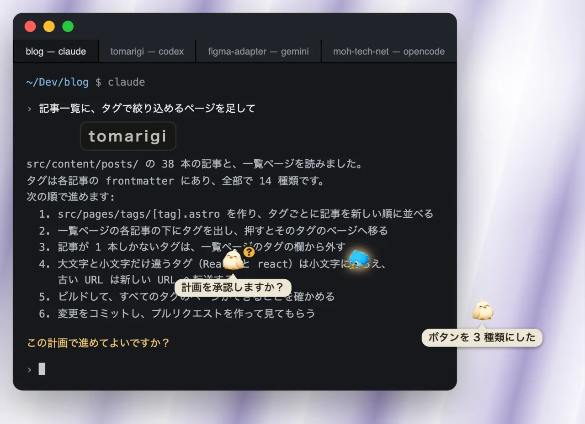

ダウンロード(デスクトップアプリ版): <https://moh-tech.net/tomarigi/desktop/>

GitHub(デスクトップアプリ版 tomarigi-desktop): <https://github.com/mohhh-ok/tomarigi-desktop> (MIT)

Chrome Web Store: <https://chromewebstore.google.com/detail/tomarigi/jgkjejameolpmmnohlgahonfejfefjgp>

紹介ページ(Chrome 拡張版): <https://moh-tech.net/tomarigi/>

## 概要

Claude Code などの AI エージェントを何本も走らせながら別の窓で作業していると、どのセッションが自分の返事を待っているのか分からなくなる。Tomarigi はセッションごとに 1 羽の鳥を出し、作業中・返事待ち・完了を見分けられるようにする。

2026/07 に Chrome 拡張版を作り、2026/09 にデスクトップアプリ版(tomarigi-desktop)を MIT のオープンソースで公開した。今はデスクトップアプリ版が中心で、2026/11 時点で v0.15.2。

## デスクトップアプリ版(tomarigi-desktop)

Tauri 2 で作ったデスクトップアプリ。常に手前に出る窓の中で、各エージェントのセッションを見守る。

- 対応するエージェントは Claude Code・Codex・Qwen Code・GitHub Copilot CLI・Gemini CLI・OpenCode・Cursor CLI。エージェント側のフックや設定の変更は要らず、各エージェントがローカルに残すセッションのファイルを読むだけ
- 「にわ」では、使っていない間は鳥と吹き出しとハンドルだけが見え、それ以外の場所のクリックは下の窓に届く。作業の邪魔をせずに、どのセッションが返事を待っているかが分かる
- 鳥を押すと、そのセッションが動いているターミナルのペインへ飛ぶ。Ghostty・iTerm2・ターミナル(Terminal.app)・WezTerm・tmux に対応し、kitty は設定を 2 行足すと飛べる。VS Code・Cursor の統合ターミナルは専用の拡張を入れると飛べる。Claude のデスクトップアプリで動くセッションは、デスクトップアプリでそのセッションを開く
- 「止まり木」はセッションの一覧で、状態とターンの要約を 1 か所で読める。別のセッションに任せた仕事は、任せたセッションの下に字下げで並ぶ。「最近の動き」には、終わったもの・返事待ちになったものが新しい順に並ぶ
- アイコンは鳥・小人・ネコ・ロボット・カエルから、プロジェクトごとに選べる(画像は gpt-image で生成)。UI は 43 言語

OpenAI か Anthropic の API キー、または Ollama・LM Studio など OpenAI 互換のサーバーで動くローカルのモデルを設定すると、次の機能が増える。キーは OS のキーチェーンに保存する。

- ターンが終わるたびに 1 回の問い合わせで、ターンを要約した吹き出しを出し、文章で聞かれた質問には鳥に「?」を付ける。同じ問い合わせで、そのターンの自分の発言が AI への暴言かどうかを判定し、暴言らしいときは鳥に怒りマークを付ける
- コンシェルジュ(フクロウ)が全部のセッションをまとめて見て、次にやることを勧める。コンシェルジュを押すと、勧めたセッションのペインへ飛ぶ。コンシェルジュのタブでは窓がコンシェルジュの大きさまで縮み、全セッションの状態の行とおすすめだけを出す

読み上げは OS の音声合成を使うので、キーが無くても使える。

macOS・Windows・Linux 向けのビルドを GitHub の Releases に置いている。Windows と Linux 向けは実機ではまだ確かめておらず、鳥を押してもターミナルの窓を手前に出すところまで(tmux の中のセッションはペインまで飛ぶ)。v0.9.0 からはアプリが自分で新しい版を確かめて更新する。

## Chrome 拡張版

先に作った Chrome 拡張版。Document Picture-in-Picture の小窓にすると、ターミナルの上に常に手前で置ける。2026/09 の 0.7.2 が最新。

- サーバーやネイティブの常駐プロセスは無い。File System Access API で Claude Code の `~/.claude/projects` や Codex の `~/.codex/sessions` を直接読み、ブラウザの中で完結する。複数のフォルダを登録して並行して見守れる
- manifest の権限はゼロ。状態の判定はローカルのヒューリスティックだけで、API キーは要らない
- 「にわ」「止まり木」「最近の動き」の 3 つのタブを持つ。「にわ」では鳥をドラッグして好きな場所に置け、うたた寝中の鳥は右下の巣箱にまとまる。サブエージェントは親セッションの下に「ひな」として出る
- 状態が変わると Web Audio で合成した鳴き声で知らせる(音源ファイルなし・ミュート可)。設定で入れると、入力待ちと完了を読み上げる。OpenAI か Anthropic の API キーを入れたときだけ、完了の読み上げが AI の要約になる
- アイコンセットはデスクトップアプリ版と同じ 5 種類。43 ロケールに対応する
