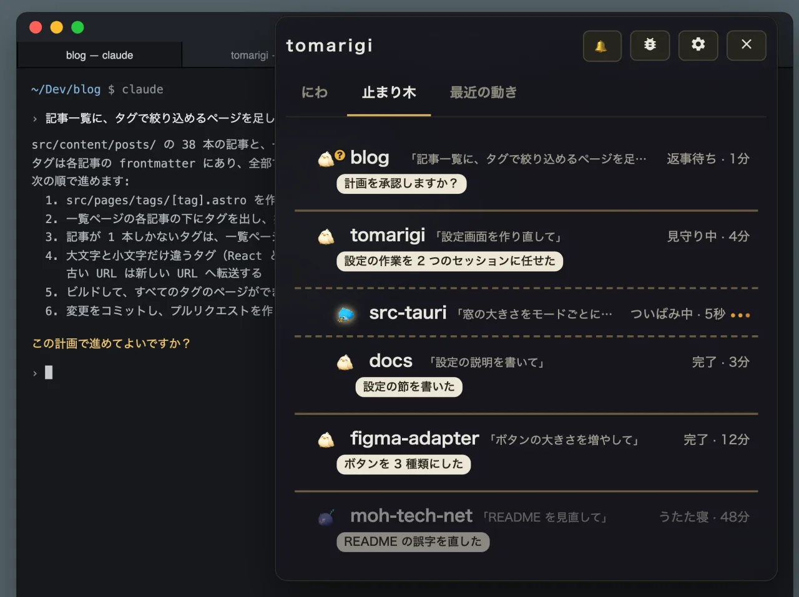
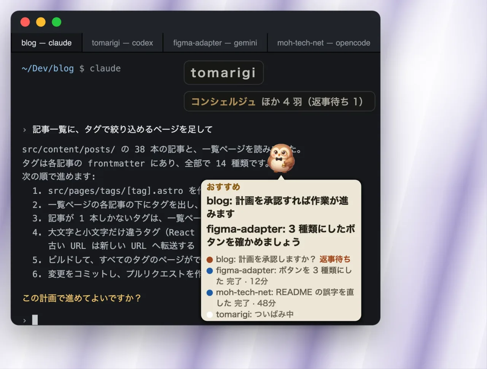
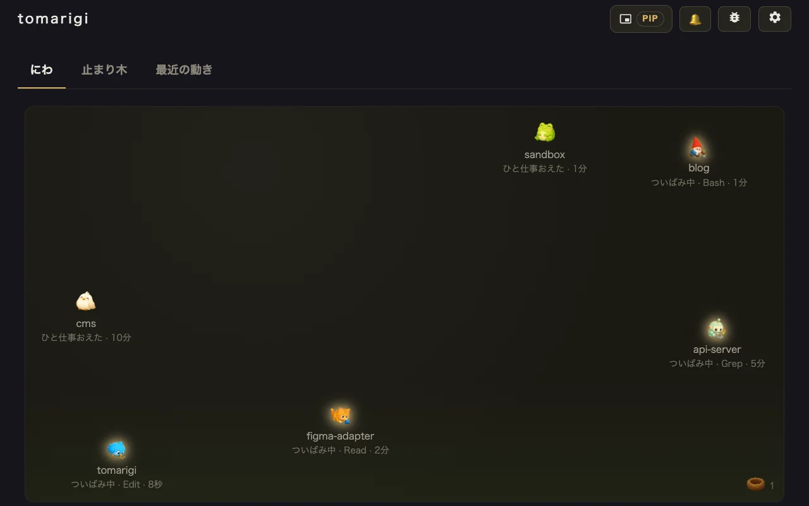

AI エージェント(Claude Code・Codex など)を何本も動かしながら別の作業をしていると、どれが自分の返事を待っているのか分からなくなる。Tomarigi はエージェントごとに 1 羽の鳥を画面の隅に出し、作業中・返事待ち・完了を見分けられるようにする。

[ダウンロード](https://moh-tech.net/tomarigi/desktop/) / [GitHub](https://github.com/mohhh-ok/tomarigi-desktop)(MIT) / [Chrome 拡張](https://chromewebstore.google.com/detail/tomarigi/jgkjejameolpmmnohlgahonfejfefjgp) / [Chrome 拡張の紹介](https://moh-tech.net/tomarigi/)

2026/07 に Chrome 拡張を作り、2026/09 にデスクトップアプリをオープンソースで公開した。今はデスクトップアプリが中心で、2026/11 時点で v0.15.2。

## できること

- 鳥はほかの窓の上に浮いていて、鳥以外の場所はクリックが下の窓に届くので、作業の邪魔にならない
- 鳥を押すと、そのエージェントが動いているターミナルへ移れる
- 一覧の画面で、全部のエージェントの状態と、直近にやったことの要約を読める
- Claude Code・Codex・Gemini CLI・GitHub Copilot CLI など 7 種類のエージェントに対応。エージェント側の設定は要らない
- AI の API キーかローカルの AI を設定すると、作業の区切りごとに要約を吹き出しで出し、フクロウが次に手を付けるエージェントを勧める
- アイコンは鳥・ネコ・ロボットなど 5 種類から選べる。画面は 43 言語に対応

## 作り

- デスクトップアプリは Tauri 2(Rust と Web 技術で作るアプリの枠組み)。macOS・Windows・Linux 向けに配布し、アプリが自分で新しい版に更新する。Windows と Linux は実機で確かめていない
- 各エージェントが手元に残す記録のファイルを読んで状態を判断する。サーバーは使わない
- Chrome 拡張は、ブラウザから手元のフォルダを読む仕組み(File System Access API)で、ブラウザの中だけで動く。状態が変わると、ブラウザで合成した鳴き声(Web Audio)で知らせる

