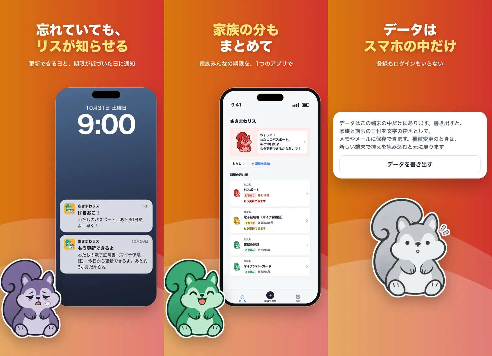

家族のマイナンバーカード・電子証明書（マイナ保険証）・運転免許・パスポート・在留カードの期限を入れておくと、更新できる時期を教えるスマホアプリ。期限が近づくほどキャラクターのリスの機嫌が悪くなり、更新を済ませると機嫌が直る。データはスマホの中だけに置き、アカウント登録は要らない。

[App Store](https://apps.apple.com/jp/app/id6832412087) / [紹介ページ](https://moh-tech.net/sakimawarisu/)

2026/11 に作り始め、2026-11-14 に App Store で公開した。iPhone 版だけで、配信は日本だけ。Android 版はまだ無い（Google Play には出していない）。

## できること

- カードやパスポートに書いてある有効期限をそのまま入れると、更新できるようになる日を計算する。マイナンバーカードは期限の 3 か月前から、パスポートは 1 年前から、運転免許証は誕生日の前後 1 か月
- 入れる欄には、券面のどこを見ればよいかを書いてある。パスポートの「20 MAR 2030」や元号の日付も、券面の書き方のまま打てる
- 更新できる時期に入った日・期限の前日・期限の日などに通知する。通知の時刻は設定で変えられる
- 家族ごとに期限を分けて持てる。ホームのリスは、全員の期限のうちいちばん急ぐものについて話す
- 期限の画面から、更新手続きを載せた公式のページ（マイナンバーカード総合サイト・警察庁・マイナポータル・出入国在留管理庁）を開ける
- データを書き出しておけば、機種を変えたときに新しい端末で読み込んで戻せる
- 無料で家族 1 人の期限を管理できる。家族の 2 人目からと、車検・保険などの「その他」の期限は購入すると使える（機能ごとの買い切りか、全部入りの月額のサブスク）

リスの機嫌は 4 段階で、ごきげん（まだ更新できない）、そわそわ（更新できる時期に入った）、げきおこ（期限まで 30 日以内）、ぐったり（期限切れ）と変わる。段階ごとに表情と体の色が変わる。

## 作り

- 画面は React と TypeScript で書き、Capacitor 8（Web の画面をアプリにする仕組み）で iOS アプリにしている。ビルドとテストは Bun
- 保存は端末の中の SQLite で、Drizzle を通して読み書きする。開発者のサーバーは無く、通知も端末の中で予約する
- 期限の計算・機嫌の段階・通知を予約する日は、画面から切り離した関数に置き、期限の種類ごとに表のテストで確かめている。年数や月数は 1 か所のデータに置き、計算も画面の説明文もそこから組み立てる
- 購入は StoreKit 2 で端末の中で確かめる。購入の記録はアプリに保存せず、起動のたびにストアに聞く
- 日本語の文は BudouX で文節に分け、文節の切れ目でだけ折り返す
- リスの絵は画像生成の GPT Image 2.6 で 1 枚作り、ほかの段階はその絵の表情と飾り（汗・怒りマーク）だけを変えて作った。段階ごとの体の色はスクリプトで塗り替えている
